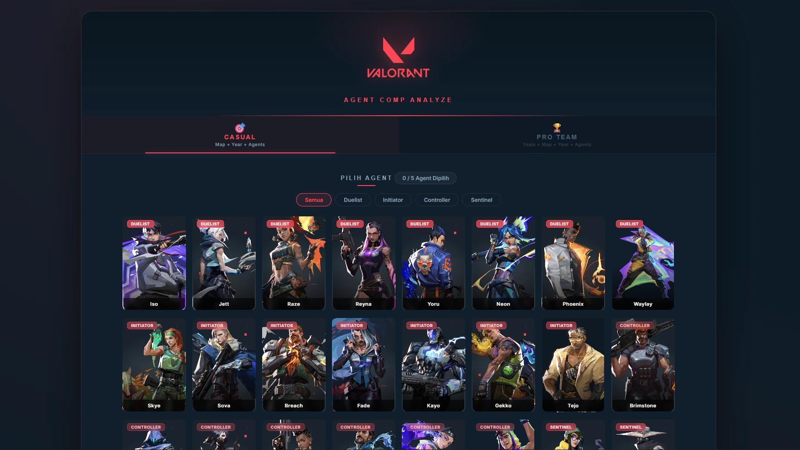
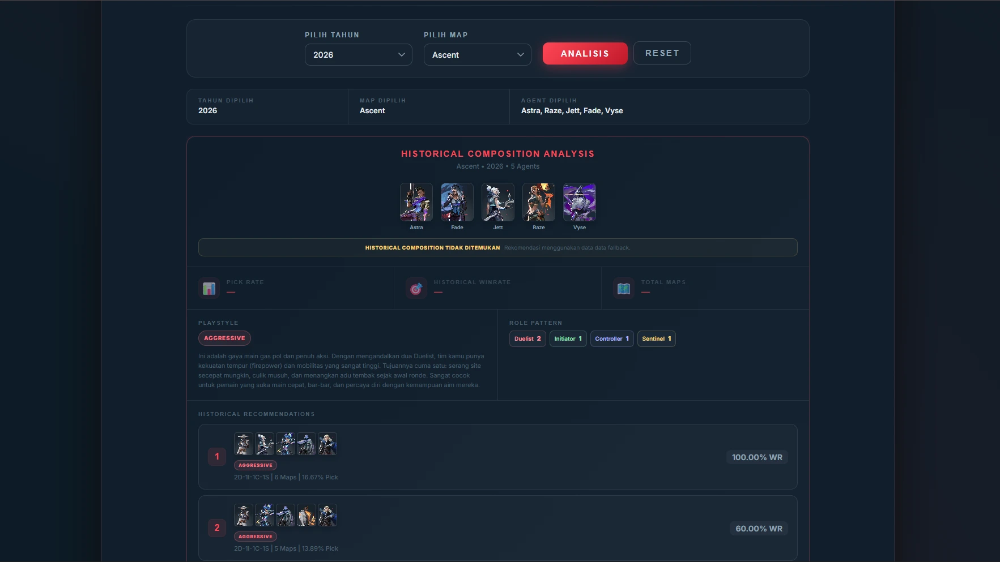
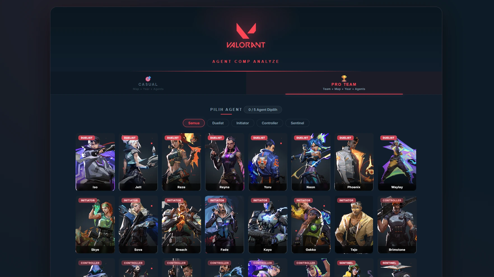
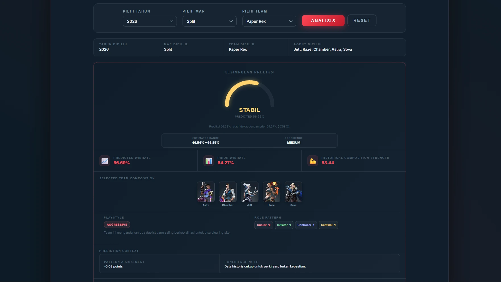

# Valorant Predictor

A web application for analyzing historical Valorant agent compositions and estimating team composition performance using machine learning.

## 1. Overview

### General





### Pro Team





Valorant Predictor provides two main features:

- **General Analysis** — analyzes historical composition performance, pick rate, playstyle, and composition recommendations based on map, year, and five selected agents.
- **Team Prediction** — estimates composition win rate for a selected team, map, year, and five-agent lineup using an XGBoost regression model.

General Analysis uses historical data analysis and rule-based classification rather than machine learning prediction. Team Prediction uses a trained ML model to estimate win rate.

## 2. Features

### General Analysis

- Analyze an agent composition based on map and year.
- View historical win rate and pick rate.
- Identify composition role patterns and playstyles.
- Explore recommendations based on historical composition data.
- Handle unavailable historical compositions through the backend's fallback behavior.

### Team Prediction

- Select a team, map, year, and five agents.
- Estimate composition win rate using an XGBoost Regressor.
- Process composition features through a dedicated feature engineering and inference pipeline.
- Return prediction details and supporting composition information through the API.

## 3. Tech Stack

| Component                     | Technology                   |
| ----------------------------- | ---------------------------- |
| Frontend                      | HTML, CSS, JavaScript        |
| Frontend tooling              | Vite                         |
| HTTP requests                 | Axios                        |
| Additional frontend utilities | jQuery                       |
| Backend                       | Python, Flask                |
| API integration               | REST API, JSON               |
| Data processing               | NumPy, pandas                |
| Machine learning              | XGBoost, scikit-learn, SciPy |
| Model serialization           | joblib                       |
| Testing                       | Python `unittest`            |
| Deployment server             | Gunicorn                     |

## 4. Project Structure

```text
Valorant-Predictor/
├── production/
│   ├── backend/
│   │   ├── app.py
│   │   ├── config.py
│   │   ├── constants.py
│   │   ├── routes/
│   │   ├── controllers/
│   │   ├── services/
│   │   ├── ml/
│   │   │   ├── artifacts/
│   │   │   └── team/
│   │   ├── data/
│   │   └── tests/
│   └── frontend/
│
├── training/
│   ├── dataset/
│   ├── general/
│   │   ├── analysis/
│   │   ├── preprocessing/
│   │   └── service/
│   ├── models/
│   │   └── team_prediction_v2/
│   ├── team/
│   │   ├── analysis/
│   │   ├── preprocessing/
│   │   ├── service/
│   │   └── train_team_v2.py
│   └── requirements.txt
│
├── .gitignore
└── README.md
```

The tree above presents the main directories; individual files and subdirectories may be omitted for readability.

### Architecture

The application separates the frontend, API layer, business logic, and ML inference pipeline.

```text
User
  |
  v
Frontend (Vite)
  |
  | HTTP / JSON
  v
Flask API
  |
  v
Routes
  |
  v
Controllers
  |
  v
Services
  |
  +--------------------+
  |                    |
  v                    v
General Analysis   Team Prediction
  |                    |
  v                    v
Historical Data    ML Inference Pipeline
                       |
                       v
                 Trained Artifacts
  |
  v
JSON Response
  |
  v
Frontend UI
```

The backend uses a lightweight MVC-inspired separation of responsibilities:

- **Routes** map URLs and HTTP methods to controllers.
- **Controllers** handle HTTP requests, validate incoming data, and return JSON responses.
- **Services** implement application and business logic.
- **ML modules** handle feature processing and inference for Team Prediction.
- **ML artifacts** contain the trained model and supporting files required for inference.

No separate MVC Model layer or application database is required by the current backend design.

### Training and Production

The `training/` directory contains development workflows for dataset preprocessing, analysis, feature engineering, model training, evaluation, and validation.

The `production/` directory contains the frontend and backend used to run the application.

Training artifacts are made available to the production backend for inference. The backend should not depend on the training directory at runtime.

## 5. API Overview

The Flask backend exposes the following endpoints:

| Method | Endpoint                                        | Description                                  |
| ------ | ----------------------------------------------- | -------------------------------------------- |
| `GET`  | `/api/options/years`                            | Retrieve available years.                    |
| `GET`  | `/api/options/maps?year={year}`                 | Retrieve available maps for a year.          |
| `GET`  | `/api/team/options/teams?year={year}&map={map}` | Retrieve available teams for a year and map. |
| `POST` | `/api/general/analyze`                          | Analyze a historical agent composition.      |
| `POST` | `/api/team/predict`                             | Predict composition performance for a team.  |

The API uses JSON for request and response data.

### General Analysis Request

`POST /api/general/analyze`

```json
{
  "map": "Ascent",
  "year": 2024,
  "agents": ["jett", "kayo", "killjoy", "omen", "sova"]
}
```

### Team Prediction Request

`POST /api/team/predict`

```json
{
  "team": "G2 Esports",
  "map": "Ascent",
  "year": 2024,
  "agents": ["jett", "kayo", "killjoy", "omen", "sova"]
}
```

Response fields and prediction details are determined by the backend API contract.

## 6. Getting Started

### Requirements

- Python 3.11 recommended for the current environment.
- Node.js and npm.
- The project dependencies listed in the relevant `requirements.txt` files.
- Git, if cloning the repository.

### Backend Setup

Open a terminal at the repository root.

Create and activate a virtual environment:

```powershell
cd production

python -m venv venv
.\venv\Scripts\Activate.ps1
```

Install backend dependencies. Adjust the requirements file path if it is stored elsewhere in the backend directory:

```powershell
python -m pip install -r backend/requirements.txt
```

Start the Flask application from the `production/` directory:

```powershell
python -m backend.app
```

The application will use Flask's development server. Check the terminal for the local address and port.

### Frontend Setup

Open another terminal:

```powershell
cd production/frontend
npm install
npm run dev
```

Open the local URL printed by Vite.

Ensure that the frontend's API configuration points to the running Flask backend. Configure CORS and the API base URL as needed for local development.

### Training Environment

The training environment has its own dependency file:

```powershell
cd training

python -m venv venv
.\venv\Scripts\Activate.ps1

python -m pip install -r requirements.txt
```

Run the appropriate preprocessing, analysis, training, or validation script from the training workflow. Consult the script's arguments and existing project documentation before executing it.

Training is not required merely to run production if the required datasets and trained artifacts are already available.

## 7. Testing

The backend API tests use Python's built-in `unittest` framework.

From the `production/` directory, with the virtual environment activated:

```powershell
python -m unittest backend.tests.test_api -v
```

The current API test suite contains 13 tests covering successful requests, input validation, error handling, unknown endpoints, and unsupported HTTP methods.

These tests mock service methods and therefore primarily verify the API layer and its response behavior. They do not replace end-to-end testing of the actual ML inference pipeline.

## 8. Machine Learning Workflow

The Team Prediction workflow includes:

1. Preparing and preprocessing the team dataset.
2. Engineering features for team and agent compositions.
3. Training the XGBoost regression model.
4. Evaluating model behavior and prediction stability.
5. Saving the model and supporting artifacts.
6. Synchronizing the required artifacts to production.
7. Loading the artifacts for API inference.

The trained model uses 116 input features according to the current model contract.

General Analysis follows a separate data-processing and historical-analysis workflow; it should not be described as ML prediction.

## 9. Demo & Links

- **Live Demo:** [Website Valorant Comp Analyzer](https://framzy-valorant-comp-analyzer.vercel.app/)
- **Repository:** [Repository Github Valorant Comp Analyzer](https://github.com/Framzy/Website-Valorant-Comp-Analysis)
